# Reconstruction & Visualisation Skill

**Don't just reformat the material. Reconstruct the story, make it visual, and make it easy for your reader to understand.**

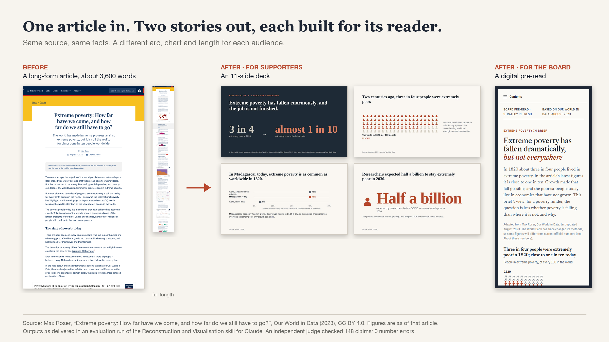

<sub>One public article, rebuilt twice by the skill for two different readers, shown as delivered. Source: Max Roser,
"Extreme poverty: How far have we come, and how far do we still have to go?", Our World in Data (2023), CC BY 4.0.
The figures are as of that article; the World Bank has since updated its data.</sub>

A [Claude Skill](https://support.claude.com/en/articles/12512180-using-skills-in-claude) that helps turn messy
documents, data, long reports and old slides into clear reports and presentations, built around what your reader
needs to understand or do.

It aims to tell a real story, use pictures and charts where they help, and stay close to what your source actually
says.

**[Install the skill](https://github.com/virapandy/reconstruction-and-visualisation-skill#install)** ·
**[See sample outputs](https://github.com/virapandy/reconstruction-and-visualisation-skill#sample-outputs)** ·
**[Download the latest version](https://github.com/virapandy/reconstruction-and-visualisation-skill/releases/latest/download/reconstruction-and-visualisation-skill.skill)**

### See it in 30 seconds

The same article as above: first the source, then the deck for supporters, then the board's pre-read on a laptop
and a phone.

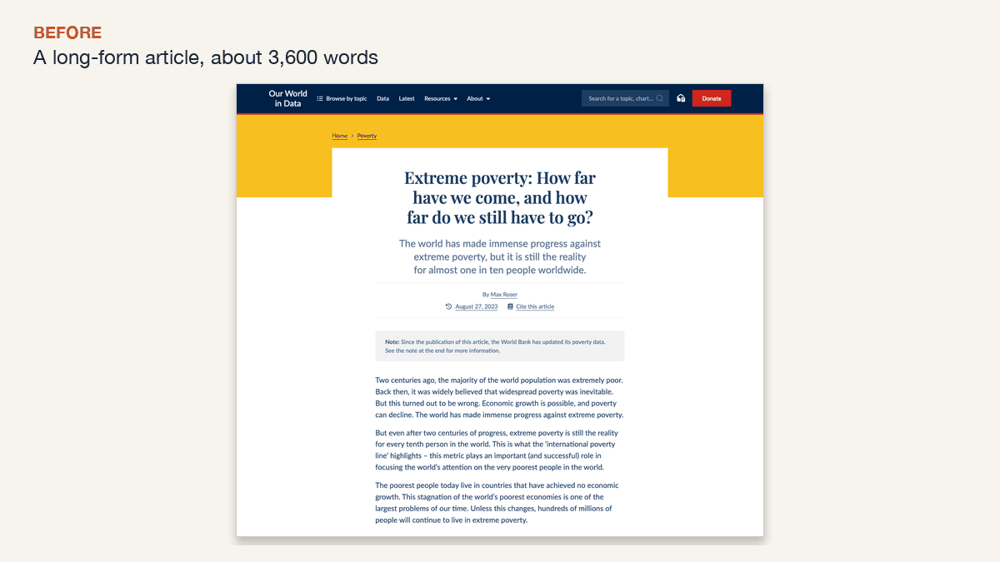

### Why it exists

This started as a personal project. I needed to turn long, messy material into documents that a particular reader
would actually read and use, and asking Claude to "make this into a deck" wasn't getting me there, so I built a skill
to do it more carefully. I already had a Claude subscription, and a skill let me use it without paying for another
tool. A few people tried it, and their early feedback was encouraging. I'm sharing it more widely
now to hear from more people: what works, what doesn't, and what you'd change. See [Feedback](#feedback) for how to
reach me.

### When to use it

It's best for the **final version** of something that matters, like a report for a board or funder, slides for an
important meeting, or anything read outside your team.

For quick notes or rough internal drafts, it's probably too much. It asks questions, waits for your go-ahead and
checks its work, and all of that takes time. For everyday notes, just ask Claude directly. If you bring it a short,
low-stakes source, it will say so and suggest that; you can still go ahead.

If you need a polished deck in a few minutes, a dedicated presentation tool will be faster and has more design
options. This skill is slower on purpose. It agrees the story and what gets cut with you, then checks what it built
against your source.

### How it works

> **You:** "Turn this report into a short deck for our board." *(and attach the report)*
>
> **Claude** asks a few questions, one at a time: who the readers are, what they already know, what you need from
> them, and **which of the four formats you want** (see below).
>
> **Claude** offers two ways to tell the story. **You** pick one.
>
> **Claude** shows the plan, slide by slide, and what it would leave out. **You** approve it or ask for changes.
>
> **Claude** builds the deck, looks at each slide, and checks the numbers against your report.
>
> **Claude** offers to have the deck checked by a separate reviewer and recommends how thorough that check should
> be. **You** choose. Claude fixes what the reviewer finds, asks you before a fix would change a point you approved,
> and hands it over with a short note on what was kept, left out or uncertain.

**You choose the format.** There are four options, and you pick one at the start:

| Format | What you get | Good for |
|---|---|---|
| **Word report** | A `.docx` file you can edit | Reports that others will edit or comment on |
| **Web report** | A web page, plus a PDF copy | Reading on screen, including on a phone |
| **Print report** | Magazine-style pages as a PDF | Printing, or handing out at a meeting |
| **Slide deck** | Slides you can download as PowerPoint or PDF | Presenting |

Whichever you choose, you also get a short note on what was kept, what was left out, and anything uncertain.

**You can bring your own look.** If you have a house style, brand guidelines or an earlier document to match, tell it
when it asks, and it will follow them instead of its own defaults. For slides, you can share your organisation's
PowerPoint template, and it fills that in rather than starting from scratch. Either way, you see a preview of the
colours, fonts and layout before anything is built.

**Who it's for:** anyone turning material into something a particular reader will use. No technical skills needed.
It works in the Claude app (web, desktop and mobile), in Cowork and in Claude Code, and tells you at the start which
version is running and what that place can and cannot check.

**What it costs:** nothing beyond your Claude plan. The skill is free and open source (MIT), and it runs on the Claude
subscription you already have, with no other tool, account or sign-up. Your documents stay in your own Claude account.

## Install

It's one file, the same for every place you use Claude:
**[download the skill file](https://github.com/virapandy/reconstruction-and-visualisation-skill/releases/latest/download/reconstruction-and-visualisation-skill.skill)**.
Then follow the steps for where you use Claude.

**Which plans:** skills work on every Claude plan, including Free. A full job is long, though (usually 45–75
minutes, about half of it Claude working), so a Pro plan or above works best. On Free, you may hit your usage limit
part way through. Claude Slides and Claude Docs are also paid features, so on Free the deck comes as a web page
instead.

### In the Claude app (web, desktop or mobile)

1. In **Settings → Capabilities**, turn on **Code execution and file creation**. Skills need it to run. The skill
   also uses it to check its own work: it measures pages, checks numbers against your source and looks at what it
   built.
2. Go to **Customize → Skills**, click **+**, then **Create skill → Upload a skill**, and choose the file.

On a Team or Enterprise plan, your organisation's owner needs to have skills and code execution switched on. They may
also have turned off uploading your own skills.

### In Cowork

Cowork uses the same skills as the rest of your Claude account, so the steps above install it there too. Then
start a task and attach your source, or point the task at the folder that holds it. Cowork needs a paid plan.

One limit for now: on the desktop app, Cowork's workspace has no web browser, and the skill uses one to look at web
pages, print pages and slides. **Word reports get every check in Cowork.** For the other three formats, use the
Claude app or Claude Code if you can. In Cowork they get fewer checks.

### In Claude Code

If you sign in to Claude Code with your Claude account, there's nothing more to do: skills you've added in the
Claude app load in Claude Code too (version 2.1.273 or later). Run `/skills` to check that it's listed.

If you use Claude Code with an API key, unzip the file into your skills folder instead:

```bash
mkdir -p ~/.claude/skills/reconstruction-and-visualisation-skill
```

```bash
unzip -o reconstruction-and-visualisation-skill.skill -d ~/.claude/skills/reconstruction-and-visualisation-skill
```

It needs Python 3, which macOS and most Linux systems already have.

**Then just ask.** For example: "restructure this report for the board", with the report attached. You don't need
to name the skill. Claude picks it up from what you ask for.

### Updating

The skill mentions it at the start of a job when a newer version is out. To update, download the file again, then:

- **Claude app, Cowork, and Claude Code signed in with your account:** in **Customize → Skills**, open the skill's
  **⋯** menu. Choose **Replace** if it's offered. If not, choose **Delete**, then upload the new file. Start a new
  chat or task afterwards.
- **Claude Code with an API key:** run the `unzip -o` command above again. It overwrites the old copy.

## What makes it different

- **You approve the key decisions.** That means the story, the plan, and what gets left out.
- **Story first, then pictures.** It works out the main message before choosing any charts.
- **It works with your structure, too.** It can keep your structure and words, find a new shape, or fill in a set
  template. If your source can't fill a section, it says so.
- **It checks its own work.** It looks at every page it builds and checks numbers and quotes against your source.
- **It offers a second check.** Before delivery, a separate reviewer that sees only your source and the finished
  document looks for claims stronger than the evidence. The skill always asks, recommends a full or a quick check from
  what is at stake, and says plainly what went unchecked if you decline.
- **Your approved points stay put.** If a fix after review would change something you approved (the main message,
  a step in the story), the skill asks you first. A paper you will decide from says what its source cannot tell you.
- **It's open about its limits.** It says which checks are enforced and which still depend on Claude's judgement.

## Tested on real jobs

The skill has been through several rounds of testing on real jobs, across different types of output. Reviewers who
hadn't seen the work compared each document with its source, looking at:

- **Accuracy:** wrong numbers, invented content, or claims stronger than the source
- **Completeness:** whether anything important went missing
- **Clarity:** whether the story and the visuals help the reader understand
- **Format:** whether it works as a report, web page, print page or slide deck

In the v1.11.0 round (five runs), the reviewers checked 658 claims and found no wrong numbers and no invented
content. The slips they did find were summary lines worded more strongly than the source. That kind of slip is what
the separate reviewer step is there to catch.

For v1.13.0, the same board pre-read job was run in the Claude app, Claude Code and Cowork, and the result was compared
with the v1.11.0 version by reviewers who did not know which was which, including three AI models from other providers.
They rated the two about equal: the v1.13.0 report read as the better-written one, the v1.11.0 report as slightly more
careful about what the source cannot say. The few slips found were again wording stronger than the source, mostly
small. v1.13.0's own gains are in staying faithful to the source, behaving the same way wherever you run it, and
explaining each step to someone using it for the first time.

For v1.14.0, the same job was run again in the Claude app and Claude Code and scored blind alongside the earlier versions. The Claude app report scored joint highest (42 of 44, level with v1.11.0), and the Claude Code report scored above the v1.13.0 Claude Code runs. This version adds a read-through from your reader's point of view, followed by a re-check against the source, and checks that each number stays about the right thing and that names come from the source or your brief. Compared with three published reports of their kind, the outputs use the same techniques but still talk about their source more than those do; that is what is being worked on next.

Problems that were found have been fixed and given automated tests, so they're less likely to come back. It isn't
perfect, though: it's still worth reading the result before you share it.

## Sample outputs

**One article, two readers (v1.11.0):** the example at the top of this page. A public Our World in Data article
became an 11-slide deck for supporters and a web pre-read for a board. Each slide is in
[`samples/owid-deck/`](samples/owid-deck/).

The three runs below are from an earlier version (v1.7.0), shown as built. Names of places, people and organisations are
replaced, and the figures are as in the sources.

**Web report:** a programme write-up, rebuilt for leaders before a strategy review.

| Opening | Evidence and timeline | Unit chart and ladder |
|---|---|---|
| 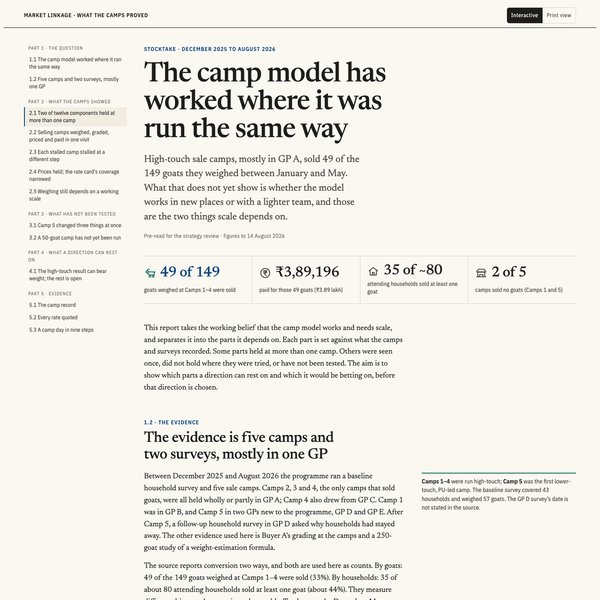 | 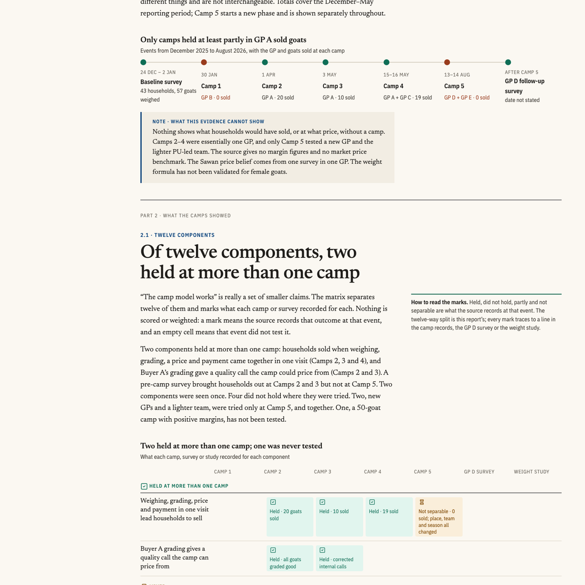 | 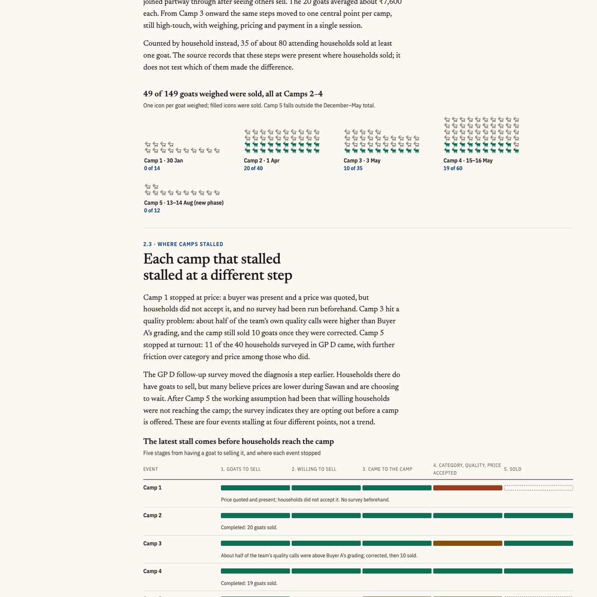 |

The same report on a phone:

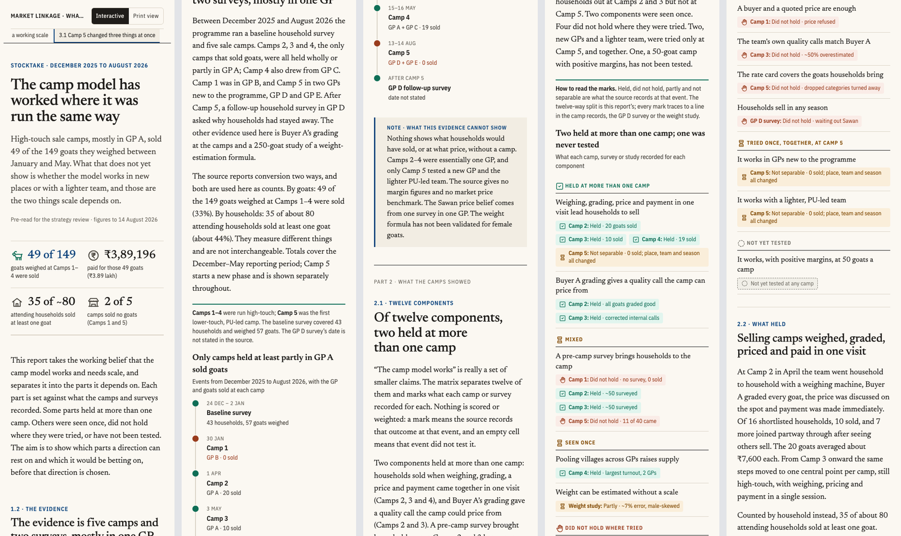

**Print report:** four A4 pages from a household spreadsheet, for a district team's quarterly meeting.

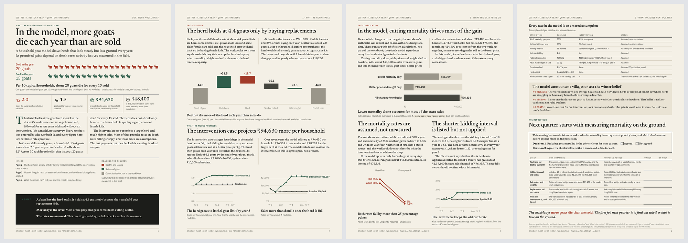

| Page 1 | Page 3 |
|---|---|
| 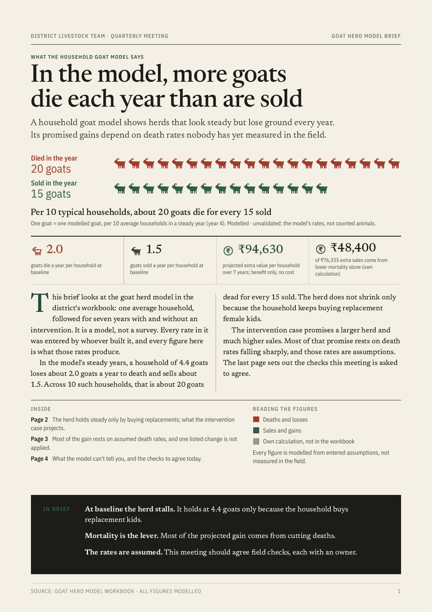 | 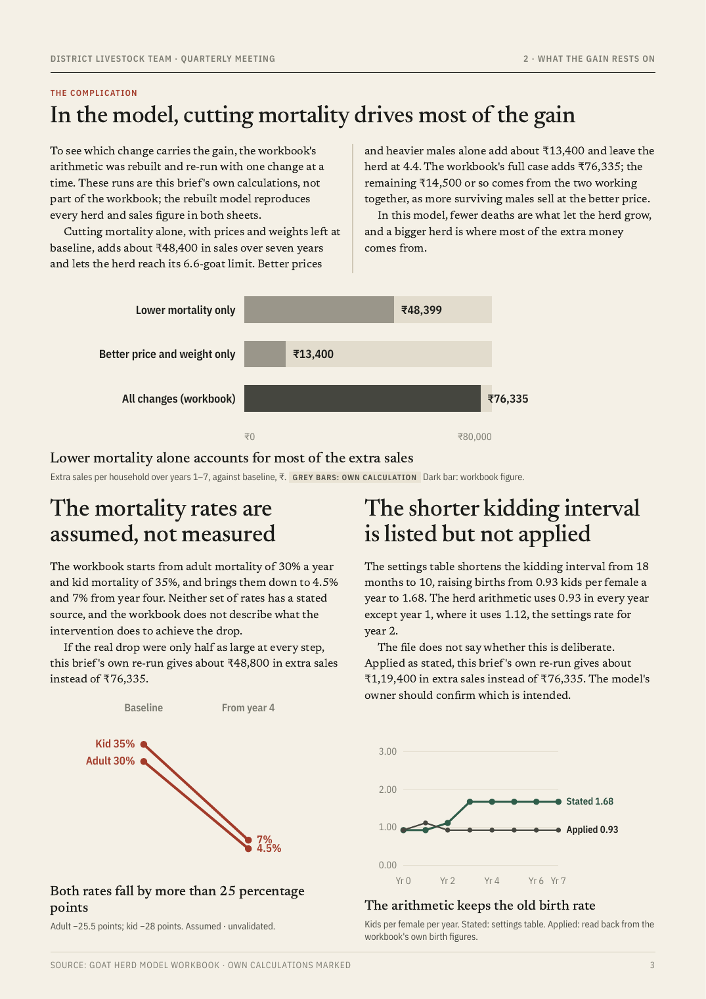 |

**Slide deck:** value-chain insights for a funder meeting, with one point and one picture per slide.

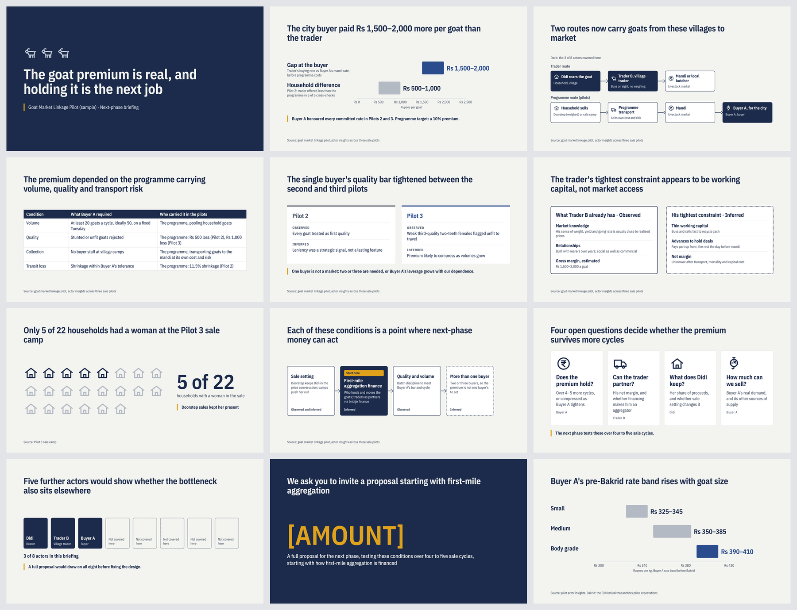

| A range chart | A unit chart |
|---|---|
| 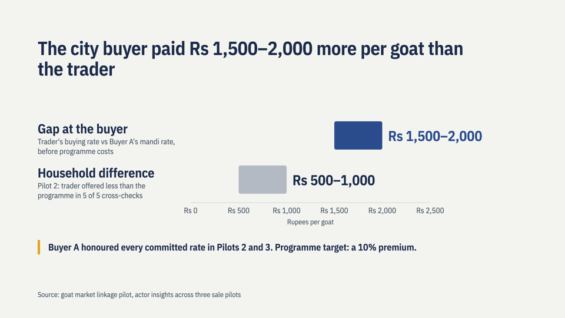 | 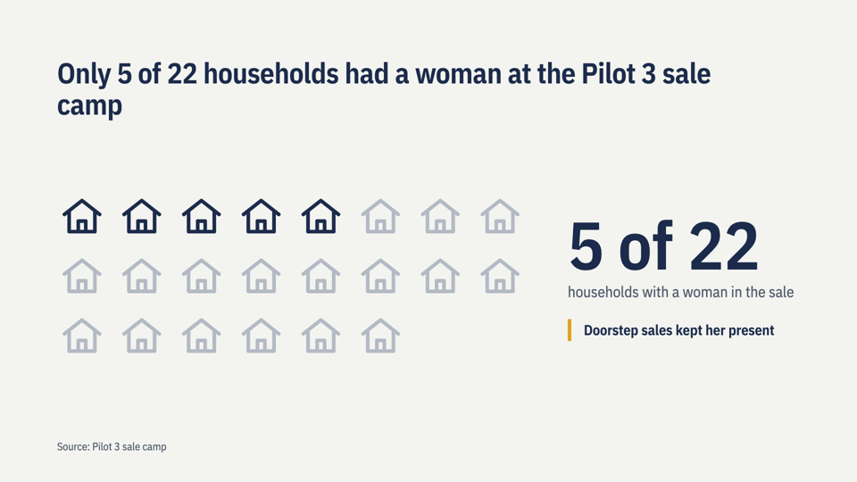 |

## Feedback

At the end of a job, the skill may offer to send a short report on how the run went. It contains no content from
your documents, and you see it in full before deciding whether to send it.

- Email: feedback.rv@gmail.com
- Issues: [reconstruction-and-visualisation-skill-feedback](https://github.com/virapandy/reconstruction-and-visualisation-skill-feedback/issues)

## Licence and credits

See [LICENSE](LICENSE). Icons are from [Tabler Icons](https://tabler.io/icons) and [Health Icons](https://healthicons.org),
and the typefaces are Newsreader and IBM Plex Sans Condensed (SIL Open Font License). Full notices and credits are
inside the package, in `assets/icons/THIRD-PARTY-NOTICES.md`, `assets/kits/fonts/OFL.txt`, `assets/kits/CREDITS.md`
and `assets/exemplars/CREDITS.md`.
